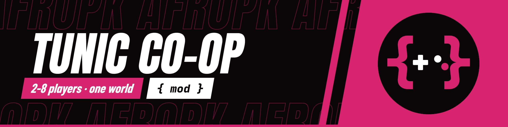
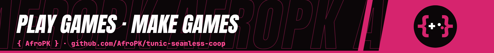

  

  
  
  
  

**`{ tunic-seamless-coop }`**: play TUNIC together — 2 to 8 players in one shared world.

Everyone sees each other, enemies and bosses are shared, progress and items belong to the whole party, and a fallen fox gets revived by a friend instead of dying. Steam, Epic and GOG copies mix and match.

> [!NOTE]
> Unofficial fan mod. Not affiliated with Andrew Shouldice, Finji or the TUNIC team. Every player needs their own copy of TUNIC. Use a dedicated co-op save — when you join, your save takes on the host's world and inventory.

| | Feature | What it does |
|---|---|---|
| 🦊 | **Seamless co-op** | 2-8 players on Steam, Epic or GOG copies, mixed freely. Same mod version on every PC. |
| 🌍 | **Shared world** | Doors, chests, bells, progress flags and inventory are shared. Money and consumables are the host's choice. |
| ⚔️ | **Shared enemies** | Each enemy runs on the nearest player and mirrors for everyone; bosses, adds and the Cathedral gauntlet stay in sync. |
| 💗 | **Down, not out** | A killing hit puts you down instead; a teammate stands next to you for 3 s and you get up with half health. |
| 🧭 | **Go to teammate** | F5 takes you to a teammate, even in another area. You're told when someone enters a boss arena. |
| 📣 | **Pings and quick chat** | F3 pings a spot with an off-screen edge marker; F4 opens six phrases. |
| 🔗 | **Easy joining** | Join codes like `4T7JA-E1QJK`, automatic UPnP port forwarding, and Steam "Join Game". |
| 📦 | **One-click install** | `Install.bat` finds TUNIC, installs BepInEx if needed (SHA-256 checked), and copies the mod in. |

**Needs:** TUNIC (Steam, Epic or GOG) · Windows · .NET is only needed to build from source

**Easy way:** download `TunicCoop-<version>.zip` from [Releases](https://github.com/AfroPK/tunic-seamless-coop/releases), extract it anywhere and double-click **Install.bat**. The first launch with BepInEx takes a minute or two.

**By hand:**

1. Find your TUNIC folder (the one with `Tunic.exe`): Steam `…\steamapps\common\TUNIC`, Epic `C:\Program Files\Epic Games\TUNIC`, GOG `C:\Program Files (x86)\GOG Galaxy\Games\TUNIC`.
2. Extract [BepInEx_UnityIL2CPP_x64_6.0.0-pre.1.zip](https://github.com/BepInEx/BepInEx/releases/download/v6.0.0-pre.1/BepInEx_UnityIL2CPP_x64_6.0.0-pre.1.zip) next to `Tunic.exe` — the same version the TUNIC Randomizer uses.
3. Copy `BepInEx/plugins/TunicCoop` from the mod zip into the TUNIC folder.
4. Start the game. A **CO-OP · Offline** panel appears top-left.

**Uninstall:** double-click **Uninstall.bat**, or delete `BepInEx\plugins\TunicCoop` and `BepInEx\config\com.freddy.tuniccoop.cfg`. Saves are never touched. It asks before removing BepInEx, and keeps it if other mods use it.

| Key | |
|---|---|
| **F1** | Co-op menu — Session, Rules, Players, Options |
| **F3** | Ping the spot in front of you |
| **F4**, then **1-6** | Quick chat: Over here! · Help! · Wait for me · Let's go! · Thanks! · Careful! |
| **F5** | Go to a teammate: whoever just entered a boss arena, otherwise cycles |
| **F7 / F8 / F9** | Host · join the saved address or code · leave |
| While downed: **Left / Right**, hold **F2** | Switch who you spectate · give up and respawn |

Host rules live in **F1 → Rules** and change live: revive on/off, revive time, health after revive, bleed-out timer, crawl while down, enemy toughness per extra player, and shared or personal money.

- **Join codes.** The host's panel shows a code like `4T7JA-E1QJK`; type it in *Join address or code*.
- **Over the internet.** Automatic port forwarding (UPnP) opens UDP 27015 on the host's router. If the router won't, forward UDP 27015 by hand or use Tailscale, ZeroTier or Radmin VPN.
- **Same network.** Use the host's LAN address or LAN code.
- **Steam.** Friends use **Join Game** on you; if TUNIC isn't running, Steam starts it and the mod joins once the save loads.
- **No port forwarding at all?** Run the small relay from `server/TunicCoopRelay` (prebuilt for Windows and Linux) on any machine reachable on UDP 27016 and set `Network.Introducer = your.relay.address:27016`. It only passes public addresses; game traffic goes direct.

- **The Heir** (final boss) hasn't been fight-tested — it needs an endgame save. It uses the same boss sync as the five bosses that were tested.
- A boss targets the player who started the fight; it won't switch targets to the others.
- Story cutscenes play for the player who triggers them. The manual's map pages don't show teammates; the co-op panel lists everyone's area instead.
- Tested on the Steam build. Epic and GOG builds of the same version should behave the same, and anything that differs switches itself off instead of breaking co-op.
- Every feature was verified on two real PCs (plus a third instance for 3-player tests) by an autopilot built into the mod. See `tools/suite.ps1` and `tools/run-all.ps1`.
- Credits: [BepInEx](https://github.com/BepInEx/BepInEx) (LGPL-2.1) and its IL2CPP/Harmony/MonoMod stack, [LiteNetLib](https://github.com/RevenantX/LiteNetLib) (MIT), and the TUNIC modding community for the BepInEx route. Built with AI: developed and tested by Claude with the author. MIT licence, no game files or decompiled code included.

  

